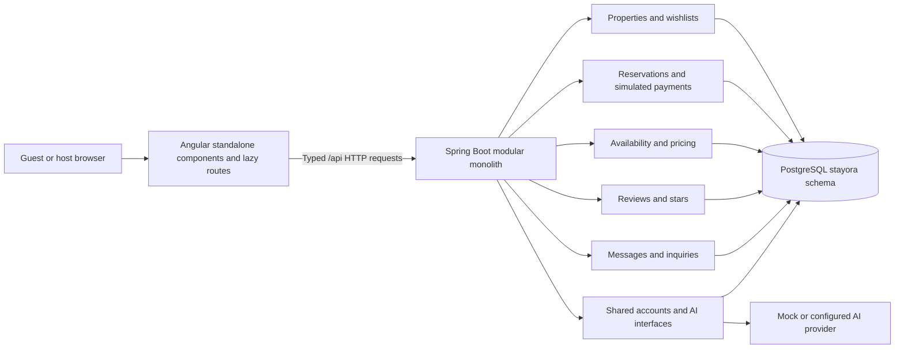

# Stayora — Technical report

## Project scope and requirements

Stayora is a client-rendered accommodation application for Tunisian destinations. Guests discover properties, save wishlists, obtain authoritative TND quotes, request stays, follow or cancel trips, exchange messages and review completed stays. Hosts manage properties, calendars, nightly prices and requests, and inspect operational statistics.

The project follows the supplied `Mini-Projet_IA_Subject_Ideas.pdf`: one Angular application, one modular Spring Boot application, five business modules, ID-based integration, one shared AI service, one AI feature and assistant skill per member, and an offline mode that does not depend on provider keys. The user-selected Neon PostgreSQL database replaces the draft brief's MySQL suggestion. Accounts are shared infrastructure and **do not count as a business module**.

The original eight screenshot/HTML references define the visual direction. The application retains the serif headings, teal actions, mint discovery surfaces, warm host/checkout surfaces and supplied imagery, with responsive layouts and reusable styles. Additional pages complete the five modules around those original screens.

This is an academic implementation with explicitly simulated financial transactions and smart-lock displays. It is not a claim of commercial deployment readiness. The separate software-testing deliverable is in French; source code, interfaces, this report and member handoffs remain in English.

## Team and business ownership

| Member           | Business module                                   | Angular area   | Backend package            | Owned tables                            | AI skill                |
| ---------------- | ------------------------------------------------- | -------------- | -------------------------- | --------------------------------------- | ----------------------- |
| Aymen Hmani      | Properties, search and wishlists                  | `listings`     | `com.stayora.listings`     | `properties`, `wishlist_entries`        | `listing-description`   |
| Hadir Ghallabi   | Reservations and simulated payments               | `reservations` | `com.stayora.reservations` | `reservations`, `reservation_payments`  | `reservation-itinerary` |
| Rania Regai      | Availability, nightly pricing and host operations | `availability` | `com.stayora.availability` | `availability_blocks`, `nightly_prices` | `host-summary`          |
| Wassim Hamouda   | Verified-stay reviews and stars                   | `reviews`      | `com.stayora.reviews`      | `reviews`                               | `review-summary`        |
| Kawther Lahneynè | Guest–host conversations and property inquiries   | `messages`     | `com.stayora.messages`     | `conversations`, `messages`             | `message-draft`         |

Shared infrastructure owns `accounts`, `account_credentials`, `account_sessions`, session authentication, request protection, common errors, configuration and AI provider integration. Detailed module explanations and demonstration guidance are in `docs/handoff/`. The ownership table and handoffs describe responsibilities; they do not fabricate individual Git histories. Members should understand, review and explain their module's actual source and evidence.

## Exact toolchain

| Technology                  | Version or convention                                  |
| --------------------------- | ------------------------------------------------------ |
| Angular framework           | 18.2.14                                                |
| Angular CLI and build tools | 18.2.21                                                |
| TypeScript                  | 5.5.4                                                  |
| RxJS                        | 7.8.2                                                  |
| Tailwind CSS                | 3.4.19, compiled during build                          |
| Development/CI Node.js      | 22                                                     |
| Spring Boot                 | 3.3.6                                                  |
| Java                        | 17                                                     |
| PostgreSQL JDBC             | 42.7.13                                                |
| Database                    | Neon PostgreSQL; isolated `stayora` schema             |
| Build/configuration         | Maven Wrapper, npm lockfiles, environment placeholders |

Angular and Spring versions match the requested Tfakkarni reference. Version changes must be deliberate rather than automatic audit upgrades. The retained toolchain's dependency findings and verification evidence belong to the final coordinator record.

## Architecture and integration boundaries

Each business package owns its controllers, services, DTOs, repositories and tables. Cross-module access uses UUIDs and service contracts rather than shared JPA entity relationships. Database foreign keys preserve referential integrity, while Java entities remain module-local. API DTOs expose only the fields required by their screens; clients cannot select another account as the actor or supply an authoritative reservation total.

The browser never connects to PostgreSQL. It requests `/api` through the Angular development proxy. Guest and host layouts share accessible components, feedback states, money formatting and icons. Lazy routes separate the feature pages. The root setup/start/check commands and CI configuration provide a common contributor workflow.

Important service contracts include `ListingService.get/lock/forHost`, `ReservationService.available/quote/get/forProperty/eligibleForReview`, and `AvailabilityService.blocked/accommodationTotal`. A property write lock is acquired inside a transaction before booking, calendar, pricing and related property mutations. The separation of read-only `AvailabilityService` from transactional `HostAvailabilityManager` avoids a dependency cycle: reservations can use availability reads while the host mutation manager checks reservation reads.

## Main routes and application flow

Original reference routes are `/explore`, `/search`, `/properties/:id`, `/reservations/review`, `/host/today`, `/host/listings`, `/host/calendar` and `/host/reservations/:id`.

Supporting routes include `/login`, `/register`, `/wishlists`, `/trips`, `/trips/:id`, `/reviews`, `/properties/:propertyId/reviews`, `/messages`, `/messages/threads/:threadId`, `/host/listings/new`, `/host/listings/:id/edit`, `/host/reservations` and host messaging routes.

The main flow is:

1. Filter published properties by destination, category, dates and party size. A results list accompanies the Leaflet map; listing selection and markers stay synchronized.
2. Open a property and ask the server for a quote. The backend checks the property, dates, capacity and availability and sums each night's effective price.
3. Confirm the simulated checkout. The backend persists a pending reservation, price snapshot and simulated payment record in one transaction.
4. The host accepts or declines the request. Acceptance confirms it. Decline changes the simulated payment record to refunded and releases dates.
5. The guest can inspect the trip and simulated receipt or cancel before the check-in date. Cancellation releases dates and records a simulated refund.
6. Participants exchange property inquiries or reservation messages. Once a confirmed stay has completed, its guest may submit one verified-stay review and manage that review later.

No credit-card data, real bank transfer or physical smart-lock connection is created by this flow.

## Module business rules

### Aymen: properties, search and wishlists

Hosts can create, update, publish, draft and archive their own properties. The server validates supported categories, geographic bounds, room/capacity limits, decimal prices, required descriptions and public HTTP/HTTPS photo URLs without embedded credentials. Image and amenity lists are bounded. Capacity cannot be reduced below an upcoming active reservation's guest count. Upcoming pending or confirmed reservations must be resolved before archiving.

Archived and draft properties are excluded from public booking/discovery. Guest wishlist writes use the current account and an idempotent unique property/account entry. Property locks coordinate wishlist saves with archiving. Search is a backend-backed filter; map tiles are a separate external display service with configurable URLs and visible OpenStreetMap attribution. Tile failure leaves the results list usable.

The listing editor can request an AI description from public listing facts. The draft remains editable and requires host review before publication; the AI does not publish a listing.

### Hadir: reservations and simulated payments

Stay dates use `[check-in, check-out)`: checkout is exclusive, so adjacent stays are allowed. The booking window must start today or later, end after check-in and span 1–90 nights. Guest count must fit the published property's capacity. Pending and confirmed bookings hold nights; declined and cancelled bookings do not.

Authoritative totals use `BigDecimal` and three fractional digits. Accommodation is the sum of per-date overrides or base nightly prices, plus cleaning and service fees. The stored reservation total is a snapshot and does not change after a later property edit. The base nightly field may differ from the average effective nightly charge when overrides apply; the accommodation subtotal is authoritative.

Creation, host decision and cancellation acquire the same property lock. Under concurrent overlapping requests, one transaction can succeed and the other sees the conflict after the lock is released. Only the guest or the owning host may read a reservation. Only its host can decide a pending request. A request with a check-in date already passed cannot be decided. Only its guest can cancel a pending/confirmed stay before check-in, with a bounded reason.

`reservation_payments` records TND amounts, references and captured/refunded timestamps in `SIMULATED` mode. It is an audit trail for the demonstration, not a payment gateway. The itinerary AI supplies advisory planning text; it does not book activities or perform payments.

### Rania: availability, pricing and host operations

Hosts can create, edit and delete owned property blocks and daily price overrides. Blocks require a nonempty bounded reason and a future start-inclusive/end-exclusive range of 1–365 days within two years. Blocks cannot overlap active reservations or other blocks. A daily override must be positive, at most 100000 TND, have at most three fractional digits, and be unique for its property/date. Changing active booked dates is rejected.

Calendar cells show reservation status, owner blocks or the effective nightly price. Dashboard occupancy is confirmed nights divided by sellable nights for published properties in the selected month. Owner-blocked nights are excluded from the denominator. Pending requests are displayed but not counted as confirmed occupancy. Payout is accommodation plus cleaning for confirmed stays whose check-in is in the selected month; it uses a simulated check-in-month accounting convention, not daily revenue recognition or bank settlement.

Host-summary AI uses aggregate business metrics. Recommendations need human review and never mutate the calendar, prices or booking state.

### Wassim: reviews and stars

A new review requires a confirmed reservation belonging to the guest, with checkout today or earlier. A unique reservation-based review prevents duplicate ratings for the same stay. Ratings are integers from 1 to 5; review text is trimmed and bounded to 10–2000 characters. The author alone can edit or delete the review.

After each review mutation, the property lock protects recomputation of the average and review count from persisted rows. Migration V8 replaces illustrative baseline ratings with actual review aggregates. Historical reviews without reservation IDs remain readable; new writes require a verified stay.

Review-summary AI receives aggregate counts and rating values rather than raw review text or reviewer identities. Its response explicitly recognizes limited samples and cannot invent guest experiences or quotations.

### Kawther: messages and inquiries

A guest can open an inquiry about a published property, or a reservation participant can open its reservation conversation. Unique conversation constraints and property locks avoid duplicate thread creation. Every thread read/write checks guest/host participation, and message edits/removals also check sender ownership.

Messages are 1–2000 trimmed characters. Edits record a timestamp. Removal clears the displayed body and preserves a tombstone. Read tracking applies to visible received rows so a later arrival remains unread. Inboxes derive unread counts and last activity from persisted data. The module uses HTTP polling/manual refresh rather than a push or external messaging provider.

AI drafts depend on a public-property context and a bounded arrival/question/checkout intent. Existing private chat history is not supplied. A suggested draft must be reviewed and explicitly sent by the participant; generating text does not send a message.

## Database and migrations

Application traffic uses pooled JDBC connections; Flyway uses the direct Neon endpoint. JDBC parameters retain `sslmode=require` and use `channelBinding=require`. Database usernames/passwords and optional AI secrets belong only to ignored `backend/.env`; `.env.example` contains placeholders. No database credential is included in the frontend, committed documentation or logs.

Flyway owns the explicitly qualified `stayora` schema; Hibernate runs in schema-validation mode. The migration sequence is:

| Migration | Purpose                                                                   |
| --------- | ------------------------------------------------------------------------- |
| V1        | Baseline accounts, properties, reservations, blocks, reviews and messages |
| V2        | Property archiving, constraints/indexes and wishlists                     |
| V3        | Cancellation state and simulated payment records                          |
| V4        | Unique per-date nightly pricing                                           |
| V5        | Verified-stay review references and timestamps                            |
| V6        | Inquiry/reservation conversations and message/read metadata               |
| V7        | Password credentials and persisted account sessions                       |
| V8        | Actual review-derived property rating/count aggregates                    |

Existing unrelated schemas, including Neon authentication objects, are outside application migrations. Development seeding uses synthetic accounts and stable IDs with conflict-safe inserts; startup does not overwrite contributor edits. Seed dates remain as originally inserted rather than silently moving every restart.

## Shared authentication and request protection

Registration and login provide guest/host accounts using salted PBKDF2-HMAC-SHA256 password hashes. Session tokens use random bytes; only a SHA-256 token hash is persisted, with a 24-hour expiry and a separate CSRF token. The browser receives an HttpOnly, SameSite=Strict session cookie scoped to `/api`. Secure-cookie behavior is configurable for local HTTP development and defaults to secure outside that development override.

Mutation requests with sessions require `X-CSRF-Token`; disallowed configured browser origins are rejected. Account identity and role checks are repeated in backend business services. Development-only identity switching remains available for demonstrations and is explicitly separate from registered-account sessions. Nondevelopment use must disable the demo identity mode. Authentication is shared support, not a sixth business assignment.

## Shared AI design and privacy

`AiSkill` defines an ID, label, owner, system prompt and deterministic mock response. Each module contributes its own Spring component. `AiService` builds the registry, rejects duplicate IDs, validates the requested skill and applies privacy reconstruction before provider execution. `GET /api/ai/skills` exposes registered skill metadata; `POST /api/ai/assist` accepts a skill and bounded context.

`AiPrivacy` rebuilds outbound context from approved destination/amenity/business vocabulary, limited numeric tokens, explicitly allowlisted scalar metrics, and labeled check-in/check-out dates. Approved metrics retain their labels; unrelated dates are discarded. Free text is not forwarded verbatim. Email/contact/URL patterns are removed; arbitrary names, chat bodies, passwords, booking/access codes and user instructions have no place in the expected input. This approach deliberately loses some prose detail and can lose unsupported relationships between values and labels. It is not a formal guarantee against every reidentification or inference risk. Use purpose-built aggregate/public context and inspect suggestions before reuse.

Provider output must be nonblank, bounded to 4000 characters, free of angle brackets, and pass the contact-pattern check. Invalid output returns the deterministic offline response. This is mechanical validation, not factual verification: users still review every suggestion. AI prompts and examples are documented in `docs/ai-prompts.md`.

Provider configuration supports mock mode, Groq, another OpenAI-compatible endpoint, or local Ollama through its compatible endpoint. Credentials remain backend-only. Missing keys, timeout, quota errors, connection failures, malformed/oversized responses and failed output validation produce a visible notice and mock fallback. An external response is labeled `mode: live`; a fallback is labeled `mode: mock`. Both declare `reviewRequired: true`.

## Validation strategy and final evidence

The project includes backend unit/integration tests, frontend unit tests, static analysis/format checks, build verification and browser-flow/responsive checks. These categories must remain distinct: an executed integration test is not a static test, and a source review is not proof that a live external AI provider was exercised.

Integration cleanup uses disposable PostgreSQL and verifies the database name before deletion; it must never target shared Neon data. Business tests cover invalid inputs, ownership, decimal totals, conflicting and concurrent bookings/calendar actions, verified reviews, messaging participation and AI fallback/privacy behavior. Frontend tests cover HTTP contracts, user agreement, duplicate submission prevention, calendar boundaries and error recovery. Root scripts and CI provide repeatable commands; module handoffs identify relevant source and demonstration scenarios.

Verified on 11 October 2026 with the pinned runtime:

- **51 backend tests passed**, including ownership, concurrent bookings, availability edits, reviews/messages, authentication/CSRF, decimal totals and AI privacy/fallbacks. Maven `verify spotless:check` also passed after recreating only the guarded local `stayora_test` schema; all eight migrations ran from a clean schema.
- **33 frontend tests passed** in Chrome Headless. Angular lint and the production build passed. The build retains Leaflet's CommonJS optimization warning.
- A fresh directory containing the current project sources and lockfiles passed root `npm ci` and `npm run setup`, without credentials. Backend packaging explicitly skipped tests in that setup check; the independent test run above executed them.
- The real Neon database migrated from V1 to V8 and the application restarted successfully. Stable seed IDs were retained. Browser-created synthetic verification records are separate from the stable seed identities.
- Chrome exercised persistent wishlists, inquiries with manual AI drafts, reservation creation, host acceptance, cancellation/refund, completed-stay review creation/deletion, real host registration, listing creation, owner blocks and nightly overrides. A date-specific quote produced the expected **445.125 TND** total.
- Fifteen original/supporting routes were checked at 1440, 768 and 390 pixels: **45 layouts**, with no document-level horizontal overflow or browser JavaScript exceptions.
- Injected API failure recovered through the visible retry control. Injected map-tile failures retained the usable listing results and visible OpenStreetMap attribution. All five registered skills returned repeatable mock responses, and the assistant UI required manual review.
- A local check confirmed that the supplied database password is absent from candidate source files and frontend output, and that `backend/.env` is ignored.

The current French professor report is [docs/testing-report/rapport.pdf](testing-report/rapport.pdf), with actual SonarQube screenshots and raw evidence. Native SonarQube 26.9 analyzed the full local source snapshot, imported JaCoCo/LCOV, and reported 67.1% total coverage with 44 open findings. Its new-code quality gate passed; overall reliability is C. Six guard tests protect the local analysis workflow. The earlier ESLint-only snapshot remains archived under `docs/static-testing-2026-10-11/`. Provider fallback was tested using a local simulated HTTP provider. No real external AI provider, bank payment or physical lock was exercised.

## Operational limits and next steps

Deployment is outside this implementation request. Live provider availability/model limits depend on configuration; mock mode is sufficient for local development and an offline demonstration. Payment/refund records and keypad displays remain simulated. There is no external property-channel synchronization, demand forecasting, autonomous pricing, push messaging, identity verification or bank settlement. Map imagery and fonts can require network access; the list and local font fallbacks remain available.

Before a real deployment, the team would need a deployment-specific authentication/session review, recovery and verification flows, appropriate dependency upgrades, monitoring, abuse/rate controls, data-retention policy, backup/restore verification, provider/data-processing decisions and production tile/service arrangements. Those decisions do not change the completed academic module ownership or the requirement to review AI suggestions.
