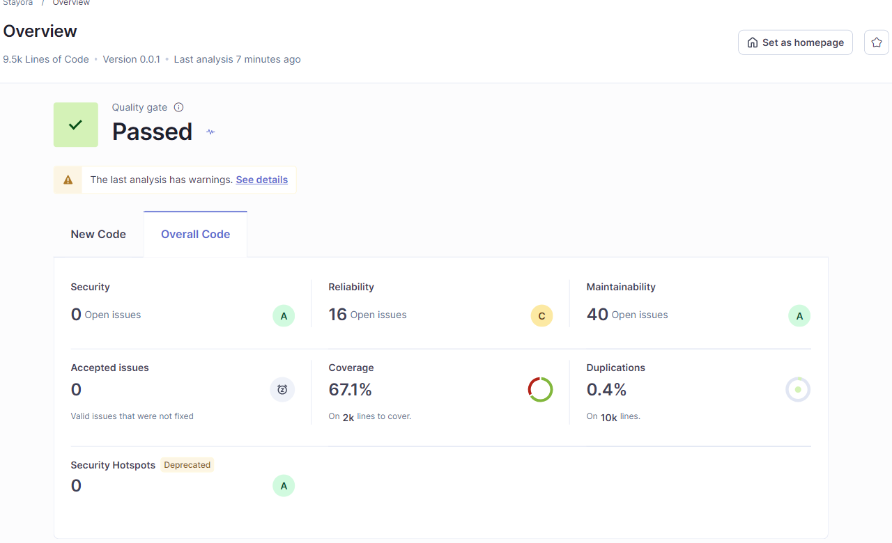
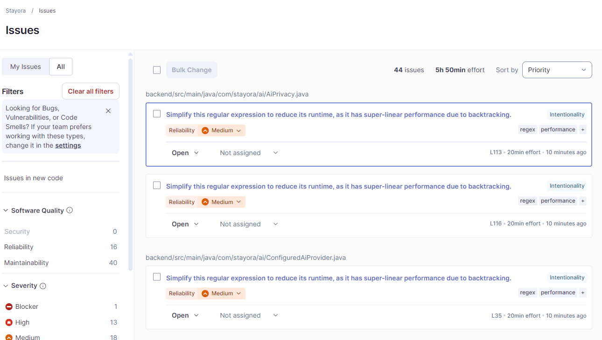

# Stayora - Rapport de tests

11 octobre 2026. Aymen Hmani, Hadir Ghallabi, Kawther Lahneynè, Rania Regai, Wassim Hamouda.

## Méthode

SonarQube Community 26.9.0.129388 sous Windows, sans Docker ; SonarScanner 8.1.0.6389, profils « Sonar way ». Analyse Java, TypeScript, HTML, CSS et YAML, avec les tests. 103 fichiers de production, 9451 lignes hors commentaires. Couverture JaCoCo 0.8.15 et LCOV ; fichiers de production absents des rapports comptés comme non couverts.

| Vérification                                                           | Résultat                   |
| ---------------------------------------------------------------------- | -------------------------- |
| Tests Java : dates, capacité, concurrence, autorisations, prix TND, IA | 51 réussis ; 0 échec       |
| Tests Angular : contrats HTTP, erreurs API et interfaces               | 33 réussis ; 0 échec       |
| Processus SonarQube : URL locale, base isolée, rapports requis         | 6 réussis ; 0 échec        |
| ESLint : 53 fichiers TypeScript / HTML                                 | 0 erreur ; 1 avertissement |
| Couverture SonarQube : Java / Angular / total                          | 85,4 % / 37,9 % / 67,1 %   |
| Duplication du code                                                    | 0,4 %                      |
| Signalements ouverts distincts                                         | 44                         |
| Qualités logicielles : sécurité / fiabilité / maintenabilité           | 0 (A) / 16 (C) / 40 (A)    |

Le portail qualité est validé pour le nouveau code (0 nouveau signalement). Les 44 signalements globaux restent ouverts ; un signalement peut concerner plusieurs qualités logicielles.

## Constats

- S8786 : expressions régulières à examiner dans `AiPrivacy.java:113,116` et `ConfiguredAiProvider.java:35`.
- S2699 : vérifier l'alerte du test d'annulation ; `expectAsync(...).toBeRejected()` est déjà présent.
- ESLint : avertissement `console.error`, `frontend/src/main.ts:20`.
- Couverture Angular : 37,9 %, à renforcer.

Édition Community sans analyse avancée des injections. Avertissements du scanner sur des types Java et des attributions Git non résolus. Tests sur PostgreSQL local ; code local non encore commité. Résultats bruts et empreintes : [preuves](evidence/verification.json).

## Captures réelles

